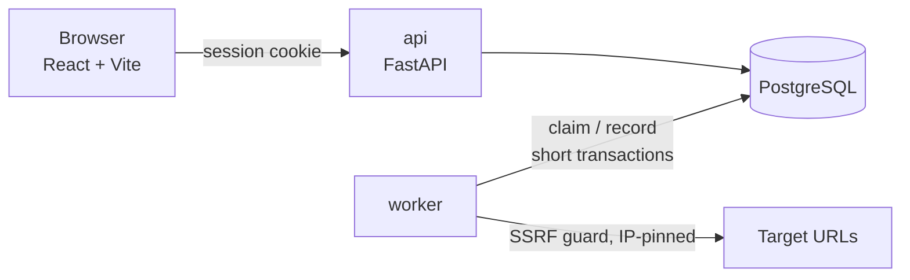

# SignalNest

A small, self-hosted **uptime monitor**. You add URLs; a worker probes them on a schedule, records
the timing of each phase (DNS, connect, TLS, first byte), says *why* a check failed, and opens an
incident after several failures in a row.

[](https://github.com/TheInfiniteLoop22/SignalNest/actions/workflows/ci.yml)

It does not try to compete with hosted monitors. It is small enough to read end to end, and it
has two parts worth looking at closely:

1. **Postgres is the job queue.** Workers claim due monitors with `FOR UPDATE SKIP LOCKED` and a
   time-bounded lease, so any number of workers can run without coordinating, and a crashed
   worker's monitors are picked up again when the lease expires.
2. **SSRF-safe probing.** The service fetches user-supplied URLs, so every resolved address is
   checked against a deny-list and the connection is pinned to the address that was checked.

## Run it

Needs Docker.

```bash
docker compose up -d --build     # db, migrations, api + UI, worker, faultline
```

Open **http://localhost:8000**, create an account, and add a monitor for
`http://faultline:8001/api/orders`. Faultline is a deliberately breakable demo API.

```bash
S() { curl -s -X POST localhost:8001/scenario -H 'Content-Type: application/json' -d "{\"mode\":\"$1\"}"; echo; }
S outage     # /api/* return 503 -> after 3 failed probes an incident opens
S healthy    # next passing probe resolves it
```

Try adding `http://169.254.169.254/` (cloud metadata). It is rejected with `blocked-target`.

## How it works



Two processes, one codebase. The API serves the UI and CRUD and never probes. The worker loops:
**claim** due monitors (transaction 1), **probe** them with no transaction open, **record** the
result, update the failure counter, open or resolve the incident and schedule the next run
(transaction 2). See [`docs/ARCHITECTURE.md`](docs/ARCHITECTURE.md).

## Develop

```bash
docker compose up -d db
uv sync
uv run pytest                                     # unit + probe + Postgres integration
uv run ruff check . && uv run mypy backend/app faultline
cd frontend && npm ci && npx vitest run && npm run build
```

## Layout

```
backend/app/probe/       probe engine, SSRF guard, failure classification (no database access)
backend/app/incidents/   incident state machine (pure function)
backend/app/worker/      queue.py (claim + record) and loop.py (concurrency, shutdown)
backend/app/api/         auth, monitors, incidents
backend/migrations/      one Alembic migration
faultline/               the fault-injection demo target, also used by the tests
frontend/                React + TypeScript UI (5 pages)
docs/                    ARCHITECTURE, DECISIONS, INTERVIEW_PREP
```

## Limits (on purpose)

No notifications, no redirects followed, GET only, no custom headers, one vantage point, no
retention job, not deployed anywhere. The full-featured version (retries, probe assertions,
diagnosis hints, metrics, deployment assets) is preserved at the `v1.0.0` tag.
