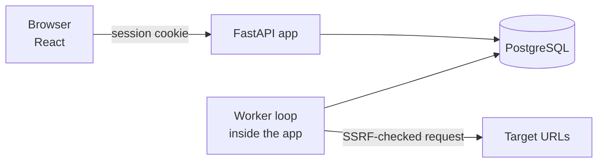

# SignalNest

**A self-hosted uptime monitor that shows you *why* a check failed.**

Add a URL and SignalNest checks it on a schedule, records how long each phase took (DNS, connect,
TLS, first byte), labels the failure, and opens an incident after several failures in a row.
It is small enough to read end to end.

[](https://github.com/TheInfiniteLoop22/SignalNest/actions/workflows/ci.yml)


**Live demo:** https://signalnest-1u4q.onrender.com (free plan, so the first request after idle can take about a minute while it wakes).

## Features

- **HTTP(S) checks** every 30 seconds to 1 hour, with a timeout, an expected status code (default
  any 2xx or 3xx) and an optional "body contains" text.
- **Per-phase timings** for every check: DNS, TCP connect, TLS handshake, time to first byte.
- **Seven failure labels**, so a red check says what kind of failure it was: `DNS`, `CONNECT`,
  `TLS`, `TIMEOUT`, `BAD_RESPONSE`, `BLOCKED`, `ERROR`.
- **Incidents.** One opens after N failures in a row (default 3, so one dropped packet does not
  raise an alarm) and resolves on the first passing check. The database guarantees a monitor never
  has two open incidents.
- **Webhook alert** (optional). A JSON `POST` when an incident opens and when it resolves; Slack and
  Discord incoming webhooks work as-is. It is sent once, best effort.
- **24-hour uptime** per monitor and a history of recent checks.
- **SSRF protection.** The server fetches URLs that users type, so it refuses private, loopback
  and cloud-metadata addresses (see [How the SSRF guard works](#how-the-ssrf-guard-works)).
- **Accounts.** Passwords hashed with argon2id, server-side sessions in an `HttpOnly` cookie, and
  every query scoped to its owner (other users' resources return 404).
- **Abuse protection.** After 5 failed logins for an email in 15 minutes, further attempts get `429`
  with `Retry-After`, even with the right password (unknown emails are throttled the same way, so
  responses never reveal which accounts exist). State-changing requests from another website's
  `Origin` are refused with `403`, on top of the `SameSite=Lax` cookie.

## Screenshots

| Monitors | Incidents |
|---|---|
|  |  |

| SSRF protection in the form | Sign in |
|---|---|
|  |  |

## Quick start

You need Docker.

```bash
git clone https://github.com/TheInfiniteLoop22/SignalNest
cd SignalNest
docker compose up -d --build
```

Open **http://localhost:8000**, create an account, and add a monitor.

The stack includes **Faultline**, a fake website you can break on purpose:

1. Add a monitor named `Orders` for `http://faultline:8001/api/orders`, interval 30 s, 2 failures
   to open an incident.
2. Break it, wait about a minute, and watch the status go **Down** and an incident open:
   ```bash
   curl -X POST localhost:8001/scenario -H 'Content-Type: application/json' -d '{"mode":"outage"}'
   ```
3. Heal it, and the next passing check resolves the incident:
   ```bash
   curl -X POST localhost:8001/scenario -H 'Content-Type: application/json' -d '{"mode":"healthy"}'
   ```

Faultline modes: `healthy`, `outage` (503s), `slow_db` (slow responses), `hang` (no response)
and `broken_contract` (200 with a bad body).

Try adding `http://169.254.169.254/` as a monitor: it is rejected as a blocked target.

## How it works



One process runs the API, serves the UI and runs the **worker**, a loop that does this every second:

1. **Find** monitors whose `next_run_at` has passed (skipping any that are still being checked).
2. **Start a check** for each, as its own task: resolve DNS, connect, do TLS, read the response, time
   each phase, and judge it (status code, body text). Checks run at the same time, so one slow
   site never delays the others.
3. **Save** each result as it finishes: apply the incident rule and set `next_run_at = now +
   interval`.

Once an hour the worker also deletes check history older than `RETENTION_DAYS` and expired sessions.
If a check hits an unexpected error it is logged and the loop carries on; `/readyz` reports `503` if
the worker ever stops.

The API and the worker never talk to each other; they share the database. A user creating a
monitor and the worker checking it are connected only by a row in the `monitors` table.

**The incident rule** is one small pure function
([state_machine.py](backend/app/incidents/state_machine.py)): a failure adds 1 to the monitor's
failure counter, a pass resets it to 0. When the counter reaches the threshold and the monitor
is not already DOWN, an incident opens; the first pass afterwards resolves it.

### How the SSRF guard works

SSRF (server-side request forgery) is when an attacker makes your server fetch a URL it should
not, such as an internal admin page or the cloud provider's credentials endpoint
(`169.254.169.254`). Because SignalNest fetches user-supplied URLs, it:

1. accepts only `http`/`https` URLs, without credentials in them, on an allowed port (default `80`,
   `443` and `8000-8999`, so the server cannot be used to port-scan other hosts);
2. resolves the hostname and requires **every** returned address to be public (Python's
   `ipaddress` knows the private, loopback, link-local and reserved ranges; IPv4 addresses hidden
   inside IPv6 forms such as `::ffff:127.0.0.1` and NAT64 are unwrapped first);
3. connects to the address it just checked, not to the hostname again, so a DNS answer that
   changes between the check and the connection cannot slip through (DNS rebinding);
4. does not follow redirects.

The check runs when you save a monitor (for a friendly error) and again on every probe.
Webhook URLs get the same treatment. Code: [ssrf.py](backend/app/probe/ssrf.py) and
[engine.py](backend/app/probe/engine.py).

### Design decisions

| Decision | Why | Trade-off |
|---|---|---|
| **One worker loop**, no job queue | "Which monitors are due?" is a database query on `next_run_at`. A crash loses nothing: the monitor is still due and is checked again. Each check is its own task, tracked in an in-memory set so a monitor is never started twice. | One worker, not many. Fine for hundreds of monitors; beyond that, claim rows with `FOR UPDATE SKIP LOCKED` so several workers can share the load. |
| **No transaction held during the probe** | Waiting on a remote server with a transaction open would tie up a database connection. | Two short database sessions per check instead of one. |
| **Incident after N failures in a row** (default 3) | One dropped packet should not be an incident. | A real outage is noticed N-1 checks late. |
| **Monitor row holds settings *and* bookkeeping** (`next_run_at`, `status`, failure counter) | One table, one row to update per check. | The table mixes configuration and state. |
| **Server-side sessions, not JWTs** | Logout and expiry are real: delete the row. Only a hash of the token is stored. | One database lookup per request. |
| **Webhook sent once** | No outbox or retry machinery to maintain. | If the receiver is down at that moment, the alert is lost (the incident is still recorded and visible). |
| **Tests probe a real local server** (Faultline) | Failure labels depend on real socket behaviour: hangs, resets, bad certificates. | Slower than mocks. |

**Stack:** Python 3.12, FastAPI, SQLAlchemy 2 (async), Alembic, httpx, PostgreSQL 16, React 18,
TypeScript, Vite, TanStack Query.

## Deploy

### Render (free plan)

The repository includes a [Blueprint](render.yaml). In Render choose **New → Blueprint**, select
this repository, and apply. It creates the app (API, UI and worker in one service), a Postgres
database and a small public demo target to monitor.

Free-plan notes: the web service sleeps when idle, which pauses monitoring until it wakes, and the
free database expires after 30 days.

### Anywhere with Docker

`docker compose up -d --build` runs three containers: `db`, `app` and `faultline`. The `app`
image creates the tables on start, then serves the API and UI with the worker inside it.

## Configuration

Environment variables (see [`.env.example`](.env.example)):

| Variable | Default | Meaning |
|---|---|---|
| `DATABASE_URL` | local Postgres | `postgres://`, `postgresql://` and `postgresql+asyncpg://` are all accepted |
| `RUN_WORKER` | `true` | Run the worker inside the app process |
| `BATCH_SIZE` | `20` | Most checks running at the same time |
| `POLL_INTERVAL_MS` | `1000` | How often the worker looks for due monitors |
| `MIN_INTERVAL_S` | `30` | Smallest allowed check interval |
| `MAX_MONITORS_PER_USER` | `50` | Per-account monitor cap |
| `ALLOW_REGISTRATION` | `true` | Allow new sign-ups |
| `RETENTION_DAYS` | `30` | How long check history is kept |
| `SHUTDOWN_GRACE_S` | `20` | How long running checks may finish when the app stops |
| `LOGIN_MAX_FAILURES` / `LOGIN_WINDOW_S` | `5` / `900` | Failed logins per email before a lock, and the window they count in |
| `TRUSTED_ORIGINS` | empty | Extra browser origins allowed to make state-changing requests |
| `ALLOWED_PORTS` | `80,443,8000-8999` | Ports a monitor or webhook URL may use |
| `COOKIE_SECURE` | `false` | Set `true` behind HTTPS |
| `SSRF_ALLOW_PRIVATE_CIDRS` | empty | **Dev only.** Lets probes reach private ranges, such as Faultline in Docker |

## API

Interactive docs are served at `/api/docs`. Errors look like `{"detail": "message"}`.

| Method and path | Purpose |
|---|---|
| `POST /api/v1/auth/register`, `/login`, `/logout` · `GET /auth/me` | Accounts and sessions |
| `GET`, `POST /api/v1/monitors` | List and create monitors (with 24 h uptime; optional `webhook_url`) |
| `GET`, `PATCH`, `DELETE /api/v1/monitors/{id}` | Read, update, delete one monitor |
| `GET /api/v1/monitors/{id}/runs?limit=50&offset=0` | Recent checks, newest first |
| `GET /api/v1/incidents?status=OPEN&limit=50&offset=0` | Incidents, open first |
| `GET /healthz`, `/readyz` | Liveness and readiness |

## Development

```bash
docker compose up -d db                 # Postgres on :5432
uv sync
uv run pytest                           # unit, probe (real sockets) and Postgres integration tests
uv run ruff check . && uv run mypy backend/app faultline

cd frontend
npm ci && npx vitest run && npm run build
```

`uv run pytest -m "not integration"` runs the tests that need no database. Tests never touch the
public internet: the probe engine is tested against Faultline and local sockets that can hang,
reset, drip bytes or serve an untrusted certificate.

```
backend/app/probe/       probe engine, SSRF guard, failure labels (no database access)
backend/app/incidents/   the incident rule (a pure function)
backend/app/worker/      the worker loop and the webhook
backend/app/api/         auth, monitors, incidents
backend/migrations/      Alembic migration (the five tables)
faultline/               the breakable demo site, also used by the tests
frontend/                React + TypeScript UI
```

## Limitations

Single vantage point and sampled availability (a check every N seconds, not continuous
observation). One worker process (the login throttle is also per process). GET requests only,
redirects are not followed, no custom request headers. Alerts are one-shot webhooks (no email, no
retries). The login lock is per email, so someone who knows an address can lock that account out for
up to 15 minutes; registration says when an email is already taken (hiding that needs email
verification). No password reset or multi-factor sign-in.

## License

[MIT](LICENSE)
