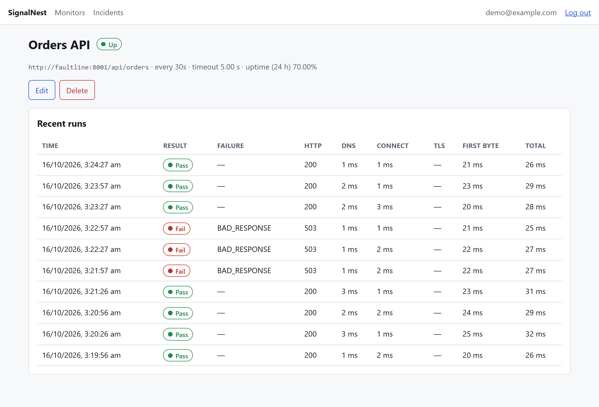
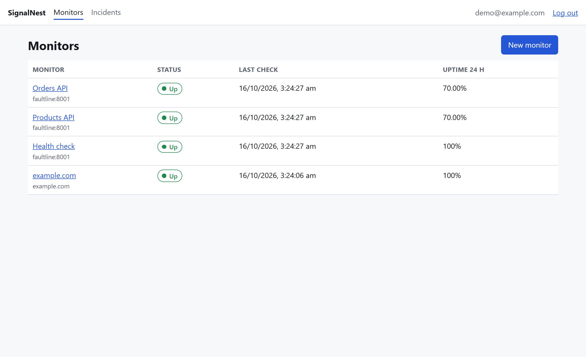
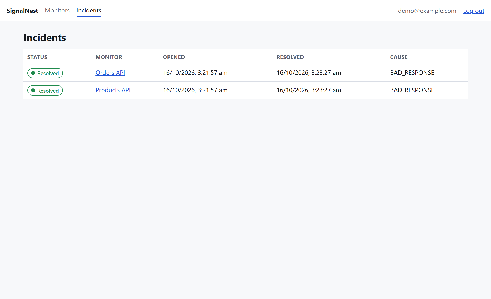
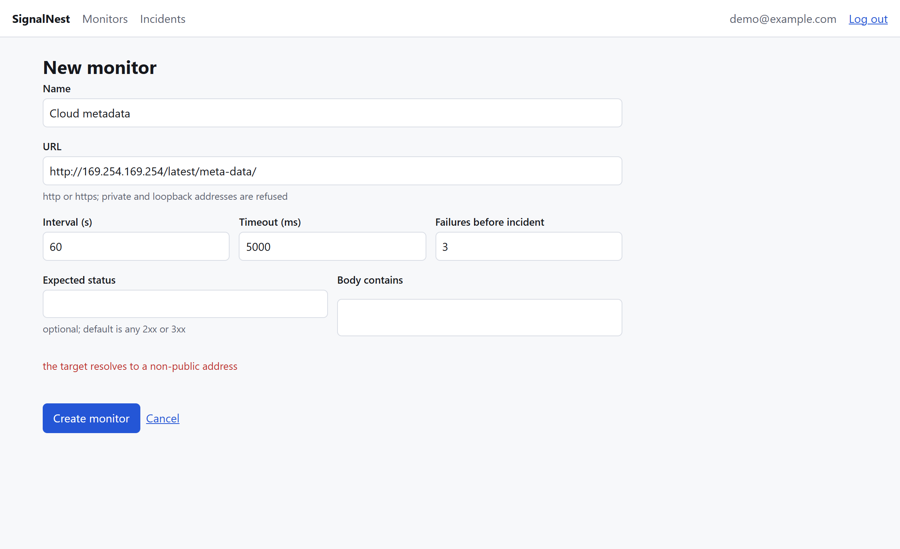
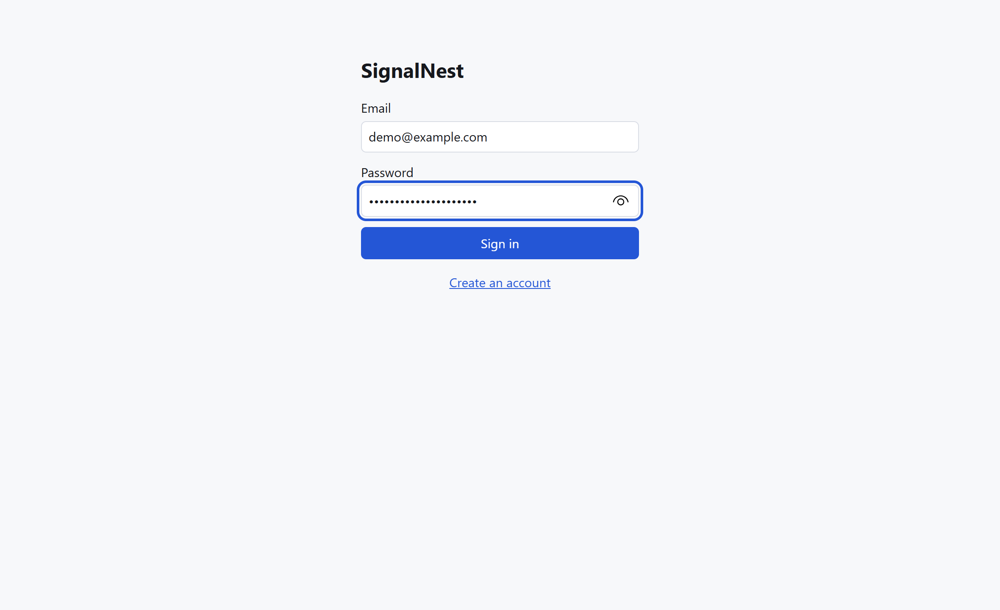
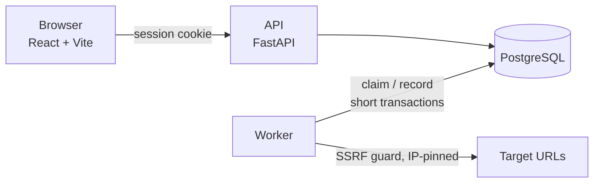

# SignalNest

**A self-hosted uptime monitor that shows you *why* a check failed.**

Add a URL and SignalNest probes it on a schedule, records how long each phase took (DNS, connect,
TLS, first byte), classifies the failure, and opens an incident after several failures in a row.
It is small enough to read end to end, with a Postgres-backed job queue and an SSRF-safe probe
engine at its core.

[](https://github.com/TheInfiniteLoop22/SignalNest/actions/workflows/ci.yml)




**Live demo:** https://signalnest-1u4q.onrender.com (free plan, so the first request after idle can take about a minute while it wakes).

## Features

**Monitoring**
- HTTP(S) checks on an interval from 30 seconds to 1 hour, with a configurable timeout.
- Pass criteria: expected status code (default any 2xx or 3xx) and an optional "body contains" text.
- Per-phase timings for every check: DNS, TCP connect, TLS handshake, time to first byte, total.
- Seven failure classes, so a red check says what kind of failure it was: `DNS`, `CONNECT`, `TLS`,
  `TIMEOUT`, `BAD_RESPONSE`, `BLOCKED`, `ERROR`.
- 24-hour uptime percentage per monitor.

**Incidents**
- An incident opens after N consecutive failures (configurable per monitor, default 3), so one
  dropped packet does not page anyone.
- It resolves on the first passing check, and its start time is backdated to the first failure.
- At most one open incident per monitor, guaranteed by a database index.
- **Webhook alerts.** Set an alert webhook on a monitor and it receives a JSON `POST` when an
  incident opens and when it resolves (Slack and Discord incoming webhooks work as-is). Alerts
  are written in the same transaction as the incident change (a transactional outbox) and
  delivered by the worker with exponential backoff, so a crash or a down receiver never loses one.
  Webhook URLs get the same SSRF protection as monitored URLs.

**Security**
- **SSRF-safe probing.** URLs are validated, every resolved address must be public, and the
  connection is pinned to the validated IP, which defeats DNS rebinding. Cloud metadata
  addresses, loopback, private ranges and non-standard ports are refused.
- Passwords hashed with argon2id; server-side sessions in an `HttpOnly` cookie, stored hashed.
- Every query on user data is scoped by owner; other users' resources return 404.
- **Login throttling.** After 5 failed logins for an email in 15 minutes, further attempts get
  `429` with `Retry-After`, even with the right password. Unknown emails are throttled the same
  way, so responses never reveal which accounts exist. The counters live in Postgres, so the
  limit holds across processes.
- **Cross-origin guard.** State-changing API requests whose `Origin` is not the app's own are
  refused with `403`, on top of `SameSite=Lax` cookies.

**Operations**
- Postgres is the job queue (`FOR UPDATE SKIP LOCKED` with a lease), so any number of workers can
  run without coordination, and a crashed worker's monitors are picked up again automatically.
- Graceful shutdown: in-flight probes finish before a worker exits.
- Data retention: the worker deletes check history older than `RETENTION_DAYS` (default 30) in
  small batches, along with finished alerts, expired sessions and stale login failures.
- RFC 9457 `application/problem+json` errors, `/healthz` and `/readyz`, interactive API docs at
  `/api/docs`.

## Screenshots

| Monitors | Incidents |
|---|---|
|  |  |

| SSRF protection in the form | Sign in |
|---|---|
|  |  |

## Quick start

You need Docker.

```bash
git clone https://github.com/TheInfiniteLoop22/SignalNest
cd SignalNest
docker compose up -d --build
```

Open **http://localhost:8000**, create an account, and add a monitor.

The stack includes **Faultline**, a deliberately breakable API at `http://faultline:8001`, so you
can see failures and incidents without waiting for a real outage:

1. Add a monitor named `Orders` for `http://faultline:8001/api/orders`, interval 30 s, 2 failures
   to open an incident.
2. Break it, wait about a minute, and watch the status go **Down** and an incident open:
   ```bash
   curl -X POST localhost:8001/scenario -H 'Content-Type: application/json' -d '{"mode":"outage"}'
   ```
3. Heal it, and the next passing check resolves the incident:
   ```bash
   curl -X POST localhost:8001/scenario -H 'Content-Type: application/json' -d '{"mode":"healthy"}'
   ```

Faultline modes: `healthy`, `outage` (503s), `slow_db` (slow responses), `hang` (no response)
and `broken_contract` (200 with a bad body).

Try adding `http://169.254.169.254/` as a monitor: it is rejected as a blocked target.

## How to use it

| Task | How |
|---|---|
| Add a monitor | **New monitor**: name, URL, interval, timeout, optional expected status and body text, failures before incident. |
| See why a check failed | Open the monitor. Each run shows the result, failure class, HTTP status and phase timings; hover a row for the error detail. |
| Watch incidents | **Incidents** lists open incidents first, then resolved ones, with the failure class that opened them. |
| Change or remove a monitor | **Edit** or **Delete** on the monitor page. Deleting removes its history. |

## Deploy

### Render (free plan)

The repository includes a [Blueprint](render.yaml). In Render choose **New → Blueprint**, select
this repository, and apply. It creates the app (API, UI and an embedded worker in one service),
a Postgres database and a small public demo target to monitor.

Free-plan notes: the web service sleeps when idle, which pauses monitoring until it wakes, and the
free database expires after 30 days. For always-on monitoring run the worker as its own service.

### Anywhere with Docker

`docker compose up -d --build` runs the same stack as a set of separate processes: `db`, `api`,
`worker` and `faultline`. The image's final stage (`hosted`) runs migrations and serves the API
with the worker embedded, for single-container platforms.

## Configuration

Environment variables (see [`.env.example`](.env.example)):

| Variable | Default | Meaning |
|---|---|---|
| `DATABASE_URL` | local Postgres | `postgres://`, `postgresql://` and `postgresql+asyncpg://` are all accepted |
| `EMBEDDED_WORKER` | `false` | Run the worker inside the API process |
| `MAX_CONCURRENCY` | `20` | Probes in flight per worker |
| `POLL_INTERVAL_MS` | `1000` | How often a worker looks for due monitors |
| `MIN_INTERVAL_S` | `30` | Smallest allowed check interval |
| `MAX_MONITORS_PER_USER` | `50` | Per-account monitor cap |
| `ALLOW_REGISTRATION` | `true` | Allow new sign-ups |
| `RETENTION_DAYS` | `30` | How long check history is kept |
| `LOGIN_MAX_FAILURES` / `LOGIN_WINDOW_S` | `5` / `900` | Failed logins per email before a lock, and the window they count in |
| `ALERT_MAX_ATTEMPTS` | `5` | Delivery attempts per webhook alert before it is marked failed |
| `TRUSTED_ORIGINS` | empty | Extra browser origins allowed to make state-changing requests |
| `COOKIE_SECURE` | `false` | Set `true` behind HTTPS |
| `ALLOWED_PORTS` | `80,443,8000-8999` | Target ports probes may use |
| `SSRF_ALLOW_PRIVATE_CIDRS` | empty | **Dev only.** Lets probes reach private ranges, such as Faultline in Docker |

## API

Interactive docs are served at `/api/docs`.

| Method and path | Purpose |
|---|---|
| `POST /api/v1/auth/register`, `/login`, `/logout` · `GET /auth/me` | Accounts and sessions |
| `GET`, `POST /api/v1/monitors` | List and create monitors (with 24 h uptime; optional `webhook_url`) |
| `GET`, `PATCH`, `DELETE /api/v1/monitors/{id}` | Read, update, delete one monitor |
| `GET /api/v1/monitors/{id}/runs?limit=50` | Recent checks, newest first |
| `GET /api/v1/incidents?status=OPEN` | Incidents, open first |
| `GET /healthz`, `/readyz` | Liveness and readiness |

## Architecture



The worker loops: **claim** due monitors (transaction 1), **probe** them with no transaction open,
then **record** the result, update the failure counter, open or resolve the incident and schedule
the next run (transaction 2).

### Design decisions

| Decision | Why | Trade-off |
|---|---|---|
| **Postgres is the job queue** (`FOR UPDATE SKIP LOCKED`), no Redis or Celery | Data and queue share one transactional system, so "record the result and schedule the next run" is a single atomic commit. | Fine for tens of probes per second; a broker would make sense beyond that. |
| **Lease column** (`locked_until = now() + 2 x timeout + 15 s`) | A crashed worker's monitors are picked up again when the lease expires. One column, one comparison. | Rarely, a monitor is probed twice. Harmless for a monitor; avoiding it needs fencing tokens. |
| **No transaction across the probe** | A transaction held open while waiting on a remote server would pin a pooled connection and row locks. | Two short transactions instead of one. |
| **Connection pinned to the validated IP** | Validating a hostname and letting the client resolve it again leaves a DNS-rebinding window. `Host` and TLS SNI still carry the hostname. | Redirects are not followed. |
| **Incident after N consecutive failures** (default 3) | One dropped packet should not be an incident. | A real outage is noticed N-1 probes late; a flapping service can flap incidents. |
| **Scheduler state on the `monitors` row** | One table and one row lock per monitor; config edits and worker updates touch different columns. | The table mixes configuration and bookkeeping. |
| **Server-side sessions, not JWTs** | Logout and expiry are real: delete the row. Only a hash of the token is stored. | One database lookup per request. |
| **Tests probe a real local server** (Faultline) instead of mocks | Failure classification depends on real socket behaviour: hangs, resets, bad certificates. | Slower than mocks, but closer to production. |

Failure handling: a worker killed mid-probe writes nothing and its lease expires; a database
outage makes the worker log, back off and retry; a monitor deleted while it is being probed is
skipped when the result arrives; two workers polling at once receive disjoint sets of monitors.

**Stack:** Python 3.12, FastAPI, SQLAlchemy 2 (async), Alembic, httpx, PostgreSQL 16, React 18,
TypeScript, Vite, TanStack Query.

## Development

```bash
docker compose up -d db                 # Postgres on :5432
uv sync
uv run pytest                           # unit, probe (real sockets) and Postgres integration tests
uv run ruff check . && uv run mypy backend/app faultline

cd frontend
npm ci && npx vitest run && npm run build
```

The suite has 148 tests that need no database (`uv run pytest -m "not integration"`) and 51 integration tests that need Postgres. Tests never touch the public internet: the probe engine is tested against Faultline and local
sockets that can hang, reset, drip bytes or serve an untrusted certificate.

```
backend/app/probe/       probe engine, SSRF guard, failure classification (no database access)
backend/app/incidents/   incident state machine (a pure function)
backend/app/worker/      queue.py (claim + record) and loop.py (concurrency, shutdown)
backend/app/api/         auth, monitors, incidents
backend/migrations/      Alembic migration
faultline/               the breakable demo API, also used by the tests
frontend/                React + TypeScript UI
screenshots/             images used in this README
```

## Limitations

Single vantage point and sampled availability (a check every N seconds, not continuous
observation). GET requests only, redirects are not followed, no custom request headers. Alerts
are webhooks only (no email). The login lock is per email, so someone who knows an address can
lock that account out for up to 15 minutes.

## License

[MIT](LICENSE)
