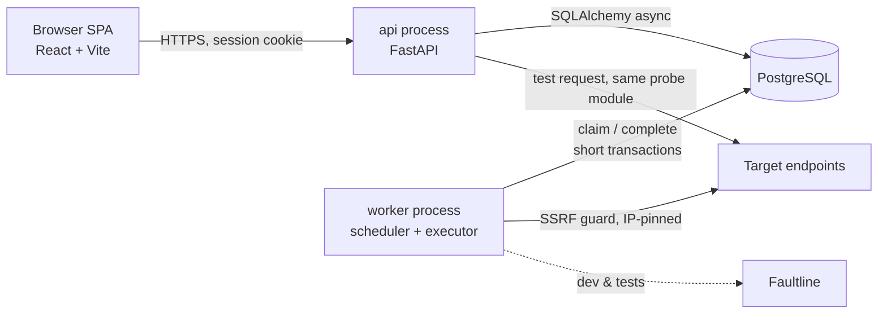

# SignalNest

> A small, self-hosted **API reliability workbench**. It probes HTTP endpoints on a schedule, records *phase-level evidence* for every check (DNS → connect → TLS → first byte), classifies **why** a check failed, groups failures into incidents with rule-based diagnosis hints, and ships with **Faultline**, a deliberately broken demo API that makes every failure mode reproducible on demand.

[](https://github.com/TheInfiniteLoop22/SignalNest/actions/workflows/ci.yml)

Most uptime tools answer *"is it up?"*. SignalNest answers *"what exactly happened, and where did the time go?"* for a developer's own handful of endpoints. It deliberately does **not** compete with UptimeRobot, Better Stack or Checkly (multi-region probing, on-call, many notification channels, status pages). The value is the engineering underneath, small enough to understand end to end:

- a **restart-safe, Postgres-backed scheduler** (`FOR UPDATE SKIP LOCKED` leases, fenced idempotent completion, bounded concurrency, graceful shutdown);
- a **probe engine** with per-phase timings and a precise failure taxonomy (14 classes);
- an **incident state machine** (pure function, hysteresis, one-open-incident guaranteed by a partial unique index);
- **SSRF-safe outbound requests** (resolve → validate every address → connect to the pinned IP);
- **deterministic tests** against a fault-injection target, never the public internet.

## Run it (2 minutes)

Needs Docker. Nothing else.

```bash
git clone https://github.com/TheInfiniteLoop22/SignalNest && cd SignalNest
docker compose up -d --build          # db, migrations, api (+ built UI), worker, faultline
```

Open **http://localhost:8000**, create an account (registration is open in dev), then add a monitor
for `http://faultline:8001/api/orders` (use **Test request** first). Faultline is on the compose
network, which is why the dev compose file allows private ranges; production never does.

### The 5-minute demo

Create monitors for `/health`, `/api/orders` and `/api/products` (30 s interval, 3 s timeout), then
flip Faultline's scenario and watch the UI:

```bash
S() { curl -s -X POST localhost:8001/scenario -H 'Content-Type: application/json' -d "{\"mode\":\"$1\"}"; echo; }
S slow_db          # /api/orders TTFB 1.5-3 s, connect normal -> DEGRADED; open a run: the waterfall shows time spent waiting
S outage           # /api/* return 503 -> 3 FAILs -> an incident opens, with a hint ("server responding with 503")
S broken_contract  # 200 OK with {"items": null} -> ASSERTION_FAILED: "up but wrong" (add a json_equals assertion)
S healthy          # 2 passing checks -> the incident resolves
```

Then try to add `http://169.254.169.254/` (cloud metadata): rejected with `blocked-target`. Kill
the worker (`docker compose kill -s KILL worker`, then `docker compose up -d worker`) and watch the
System page and the leases recover.

## Architecture



Two processes from one codebase: the **API** never schedules, the **worker** is the only
scheduler, and **Postgres is the queue**. A probe is two short transactions around the network
call; no transaction is ever open while waiting on a target. Details: [`docs/04_ARCHITECTURE.md`](docs/04_ARCHITECTURE.md),
decisions and trade-offs: [`docs/08_ENGINEERING_DECISIONS.md`](docs/08_ENGINEERING_DECISIONS.md) (24 ADRs).

## Measured

Numbers below were measured, with the command recorded. They describe **this setup**: a 20-core
Windows 11 laptop where Postgres (Docker Desktop), Faultline, the worker(s) and the load script all
share the machine. They are not a deployment benchmark.

| What | Result | Command |
|---|---|---|
| Backend tests | 292 passing (unit, probe integration, Postgres integration, worker, API) | `uv run pytest -q` |
| Backend line coverage | 95 % (`app/`, excluding the two process entrypoints) | `uv run pytest --cov` |
| Frontend tests | 49 passing; `tsc --noEmit` clean; `vite build` ok | `cd frontend && npx vitest run` |
| Type checking | `mypy --strict` clean on `app/probe`, `app/incidents`, `app/worker` | `uv run mypy --strict backend/app/probe backend/app/incidents backend/app/worker` |
| SSRF classification | 48 address cases + 30 URL cases + rebinding / mixed-answer / pinning tests | `backend/tests/unit/test_ssrf.py`, `backend/tests/probe/test_pinning.py` |
| 200 monitors @ 30 s, 1 worker (6.7 probes/s) | 557 runs vs ~533 expected, 0 duplicates, dispatch delay p50 544 ms / p95 1.2 s, scheduler lag max 3.7 s | `python ops/load_experiment.py --monitors 200 --interval 30 --duration 80` |
| 1000 monitors @ 30 s, **1 worker** (33 probes/s) | **Saturated**: 1560 of ~2667 expected runs (58 %), 0 duplicates, scheduler lag grew to 36 s | `... --monitors 1000 --interval 30 --duration 80` |
| 1000 monitors @ 30 s, **2 workers** | 2741 runs vs ~2667 expected, 0 duplicates, dispatch delay p50 629 ms / p95 2.7 s, scheduler lag max 3.3 s | `... --monitors 1000 --interval 30 --duration 80 --workers 2` |

What the load runs say: one worker process sustains roughly 20 probes/s here (the event loop is the
limit, not the database or concurrency: in-flight probes stayed near zero), and a second worker
process restores headroom with no coordination and no duplicate slots, which is the point of the
lease design. Dispatch delay has a floor of about half the 1 s poll interval. The 80 s windows are
short; treat them as an order-of-magnitude check, not a capacity plan.

## Security

Threat model and controls: [`docs/09_SECURITY.md`](docs/09_SECURITY.md), including a control-by-control
review for this release. Highlights: SSRF guard with IP pinning and IPv4-in-IPv6 unwrapping;
argon2id passwords and hashed server-side sessions; `SameSite=Lax` plus a required header on unsafe
methods; `owner_id` on every query with 404-not-403 (a route crawler test enforces it); response
snippets rendered as text only; CSP and friends on every response; non-root, read-only
production containers; `pip-audit`, `npm audit` and secret scanning in CI.

## Limitations (read these)

- **Not deployed anywhere.** The production assets exist and were exercised on a developer
  machine (`docs/13_REPO_AND_DEVOPS.md` section 5.4 lists exactly what was and was not verified),
  but no VM, domain, public HTTPS URL or off-host backup has been set up. The restore drill has only
  been run against a tiny local dataset.
- **Single vantage point** and sampled availability: a check every N seconds, not continuous
  observation. Uptime % counts checks, not time.
- **No notifications.** Incidents are in-app only; the webhook outbox is the first "next iteration" item.
- **GET/HEAD only**, no redirect following, no secret headers, no browser checks.
- **Rate limits are per process** (in-memory fixed windows); with several API replicas the effective
  limits multiply and a restart resets them. One API replica is assumed.
- **One probe-process ceiling of ~20 probes/s** on the measured setup; scale by adding workers.
- **No zero-downtime deploys**; a few seconds' gap while the API container restarts.
- Two moderate `npm audit` findings remain in `react-router` (open redirect via backslash,
  SSR-hydration injection). The app does no SSR and never navigates to user-supplied locations; the
  fix is a breaking v7 upgrade, deferred.
- No demo GIF or screenshots are included; the demo above is reproducible instead.
- The bundle is ~700 kB (205 kB gzip), mostly Recharts, with no code splitting.

## Status

The MVP scope is milestones M0-M10 in [`docs/12_BUILD_PLAN.md`](docs/12_BUILD_PLAN.md), which also
holds the full deviations log. M0-M8 and M10 are complete; **M9 (deployment) is built and verified
locally but not provisioned**. Next iteration candidates: webhook outbox, probe canary, rollups,
encrypted secret headers, safe redirect following, Playwright e2e.

## Repository map

```
backend/app/{api,services,probe,incidents,worker,db,observability}   application code
backend/migrations/      Alembic migrations (every one has a downgrade)
backend/tests/           unit, probe (real sockets), integration (real Postgres)
faultline/               the fault-injection target + socket faults
frontend/                React + Vite + TypeScript SPA
ops/                     backup.sh, restore-drill.sh, load_experiment.py
docs/                    planning pack (00-15), ADRs, runbook, build plan
```

## Documentation

| File | Read it when... |
|---|---|
| [`docs/00_EXECUTIVE_ASSESSMENT.md`](docs/00_EXECUTIVE_ASSESSMENT.md) | Is this worth building? Scope decisions, risks. |
| [`docs/01_COMPETITIVE_RESEARCH.md`](docs/01_COMPETITIVE_RESEARCH.md) | How it compares to Uptime Kuma, Checkly, etc. |
| [`docs/03_FEATURE_SPEC.md`](docs/03_FEATURE_SPEC.md) | Product scope and acceptance criteria. |
| [`docs/04_ARCHITECTURE.md`](docs/04_ARCHITECTURE.md) | Components, flows, failure behaviour. |
| [`docs/05_DATA_MODEL.md`](docs/05_DATA_MODEL.md) | Tables, constraints, transactions. |
| [`docs/06_API_SPEC.md`](docs/06_API_SPEC.md) | REST surface and error format. |
| [`docs/07_PROBE_ENGINE_SPEC.md`](docs/07_PROBE_ENGINE_SPEC.md) | Timings, failure taxonomy, retries, assertions. |
| [`docs/08_ENGINEERING_DECISIONS.md`](docs/08_ENGINEERING_DECISIONS.md) | Every important decision and its alternatives. |
| [`docs/09_SECURITY.md`](docs/09_SECURITY.md) | Threat model, SSRF defence, v1.0 control review. |
| [`docs/10_FAULTLINE_SPEC.md`](docs/10_FAULTLINE_SPEC.md) | The demo / test target. |
| [`docs/11_TESTING_PLAN.md`](docs/11_TESTING_PLAN.md) | Test layers and CI gates. |
| [`docs/12_BUILD_PLAN.md`](docs/12_BUILD_PLAN.md) | Milestones, progress and deviations. |
| [`docs/13_REPO_AND_DEVOPS.md`](docs/13_REPO_AND_DEVOPS.md) | Layout, env vars, CI, deployment. |
| [`docs/14_OBSERVABILITY_AND_RUNBOOK.md`](docs/14_OBSERVABILITY_AND_RUNBOOK.md) | Logs, metrics, runbook R1-R7. |
| [`docs/15_INTERVIEW_PREP.md`](docs/15_INTERVIEW_PREP.md) | Questions, honest resume claims, demo. |
| [`CHANGELOG.md`](CHANGELOG.md) | What changed per milestone. |
| [`CLAUDE.md`](CLAUDE.md) | Working agreement for AI-assisted development of this repo. |
