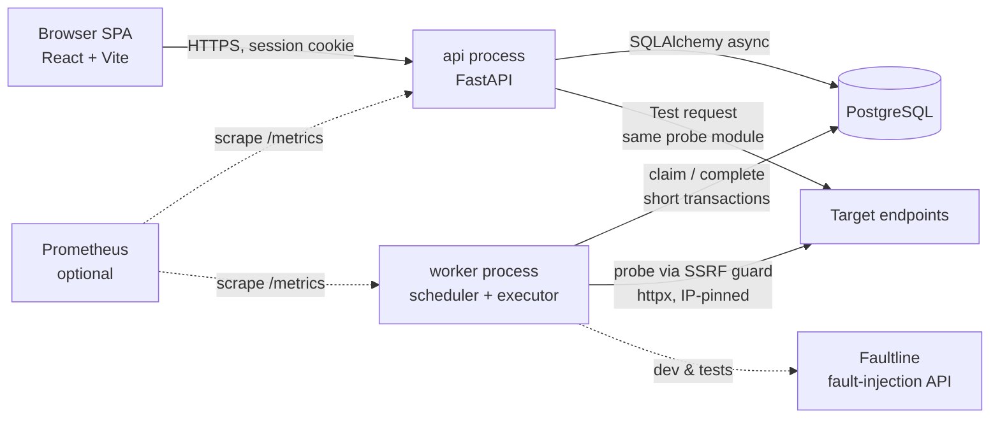

# 04 — Architecture

## 1. Shape: a modular monolith with two entrypoints

One Python package (`app/`), one Docker image, **two processes**:

- `api` — FastAPI: auth, CRUD, queries, "test request", health/metrics.
- `worker` — scheduler loop + probe executor + incident evaluation + retention job.

Plus Postgres, the React SPA (served as static files behind the API or by a tiny static server), and Faultline (dev/demo only).

Why two processes and not one? A slow probe storm must never make the API slow, and the API must be safely scalable to N replicas without N schedulers (ADR-003). Why not microservices? Both processes share models, the database and the release cycle; splitting repos/services would add network calls and deployment work with no benefit at this scale.



## 2. Module boundaries (inside `app/`)

| Module | Responsibility | Must not |
|---|---|---|
| `api/` | HTTP routers, request/response schemas, auth dependencies | Contain business rules or SQL beyond calling services |
| `services/` | Monitor, run, incident, stats use-cases; transaction boundaries | Know about HTTP request objects |
| `probe/` | `ssrf.py` (resolve + validate), `engine.py` (execute attempts, timings), `classify.py` (exceptions → failure class), `assertions.py` | Touch the database |
| `incidents/` | `state_machine.py` — **pure** function `evaluate(state, outcome, thresholds) → (new_state, transitions)`; `hints.py` — deterministic rules | Do I/O |
| `worker/` | Claim loop, semaphore, lease handling, shutdown, heartbeat, retention job | Contain probe logic |
| `db/` | Engine/session factory, models, Alembic migrations | — |
| `observability/` | JSON logging config, metrics registry, request-id middleware | — |

`probe/` and `incidents/` are pure-ish and DB-free on purpose: they are the parts you most need to unit-test and explain.

## 3. State ownership

| Data | Owner (writes) | Readers |
|---|---|---|
| `users`, `sessions` | api | api |
| `monitors` (config) | api (user actions) | worker (read-only) |
| `monitor_state` (next_run_at, lease, health, counters) | **worker**; api may only set `next_run_at = now()` ("check now") and `health = PAUSED/UNKNOWN` on pause/resume | api, UI |
| `check_runs` | worker | api |
| `incidents`, `incident_events` | worker | api |
| `worker_heartbeats` | worker | api |

Keeping config and runtime state in separate tables means a user editing a monitor's name never contends with the worker updating its counters, and it makes "who is allowed to change what" explicit.

## 4. Main flows

### 4.1 Scheduled probe (the critical path)

```mermaid
sequenceDiagram
    participant W as Worker loop
    participant DB as Postgres
    participant G as SSRF guard
    participant T as Target
    W->>DB: TX1 claim: SELECT due monitors FOR UPDATE SKIP LOCKED LIMIT free_slots;<br/>set lease_owner, lease_expires_at; COMMIT
    Note over W: no transaction held from here
    W->>G: resolve(host) + validate all IPs
    alt blocked
        G-->>W: BLOCKED_BY_POLICY
    else allowed
        W->>T: HTTP request to pinned IP (Host + SNI = hostname)
        T-->>W: response / error (timings via trace hooks)
        W->>W: classify, evaluate assertions, maybe 1 retry
    end
    W->>DB: TX2 complete: INSERT check_run ON CONFLICT DO NOTHING;<br/>update monitor_state (only if lease_owner = me);<br/>apply incident transitions; advance next_run_at; clear lease; COMMIT
```

**Key invariants**
- TX1 and TX2 are each a few milliseconds. The network call between them can take up to `timeout × attempts`.
- `UNIQUE (monitor_id, scheduled_for)` makes TX2 idempotent: if a run for this slot already exists (lease was lost and someone else completed it), the insert is a no-op and state updates are skipped.
- `next_run_at` advances from the *scheduled* time, not completion time (no drift), but is clamped to `≥ now()` so a worker that was down doesn't replay missed slots (AC11).

### 4.2 Create monitor
`POST /monitors` → validate schema → SSRF pre-check (scheme, port, literal-IP and resolved-IP check; a DNS answer can change later, so execution re-checks) → per-user cap check → INSERT `monitors` + `monitor_state(next_run_at = now() + random jitter ≤ interval)` in one transaction.

### 4.3 Check now
`POST /monitors/{id}/check` → set `next_run_at = now()` if not currently leased → 202. The worker picks it up on its next poll. No synchronous probing on this path (keeps the API fast and the worker the only scheduler).

### 4.4 Test request (unsaved)
`POST /probe/test` → rate-limited per user (e.g. 6/min) → runs the *same* `probe` module inside the API process with a hard 10 s cap → returns the result without storing it. This is the only place the API makes outbound requests.

### 4.5 Incident evaluation
Inside TX2: `evaluate(current_state, outcome, thresholds)` returns the new health state, updated counters, and zero or more transitions (`OPEN`, `CLASS_CHANGED`, `RESOLVE`). The service applies them: insert incident (guarded by the partial unique index), append `incident_events`, set resolving run. Because it's in the same transaction as the run insert, a crash can never leave a run recorded without its incident effect (or vice versa).

## 5. What happens when things fail

| Failure | Behaviour | Why state stays consistent |
|---|---|---|
| Target down/slow | Run recorded with failure class; counters advance; incident may open | Normal path |
| Worker crashes mid-probe | Lease expires (lease = timeout × 2 + 15 s); another claim picks the monitor | TX1 committed only the lease; no partial run exists |
| Worker crashes after TX2 starts but before commit | Postgres rolls back TX2; lease later expires; slot re-run | All-or-nothing transaction |
| Two workers, lease expired while first is still probing (slow) | Second worker probes same slot; whichever commits first wins; the other's insert hits `ON CONFLICT DO NOTHING` and its state update is skipped because `lease_owner` ≠ it | Unique constraint + conditional update ("fencing") |
| Postgres unavailable | Worker: claim loop backs off exponentially, logs, `/readyz` fails; API: `/readyz` 503, requests 503 | No writes possible → nothing inconsistent; in-flight results discarded and re-run later |
| Worker's own network/DNS broken | Runs `INCONCLUSIVE` (classified as probe-side errors), not counted in incidents or uptime | Separate outcome |
| API down | Monitoring continues (worker independent) | Process separation |
| Clock skew between processes | All scheduling uses Postgres `now()`, not process clocks | Single time source |
| Retention job vs. incident referencing an old run | Retention never deletes runs referenced by incidents (FK `ON DELETE RESTRICT` + job filters them) | FK |

## 6. Scale thinking (for interviews — not to be built)

Rough load: 1 monitor @ 30 s = 2,880 runs/day. 100 monitors ≈ 288k rows/day → ~4M rows over 14-day retention. Fine for one Postgres with the `(monitor_id, started_at DESC)` index.

| At… | Bottleneck | Change |
|---|---|---|
| ~1k monitors | Worker outbound concurrency; run-table growth | More worker replicas (already safe); monthly partitions on `check_runs`; rollups |
| ~100k monitors | Claim query hot spot; write volume | Shard monitors by hash across worker groups; batch inserts; time-series store for runs |
| Multi-region | Single vantage point | Workers per region tagging `location`; incident = majority of locations failing |
| Many tenants | Noisy neighbours | Per-tenant quotas, fair scheduling, separate queues |

Redis/Kafka become reasonable only when Postgres write/claim throughput is measured to be the limit — not before.
