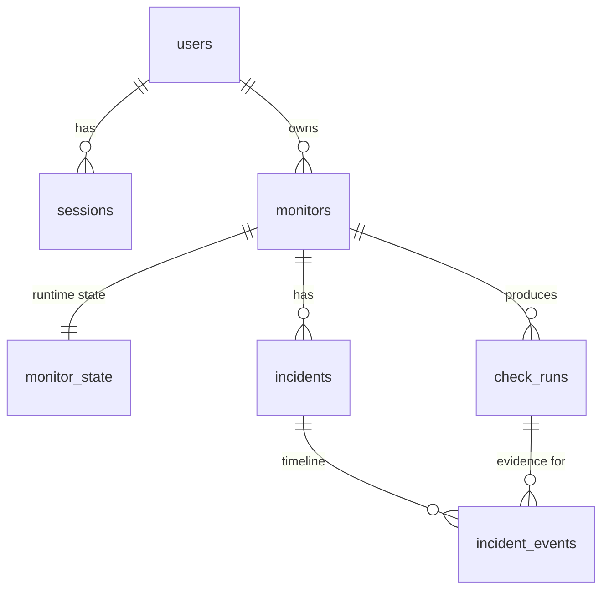

# 05 — Data Model

PostgreSQL 16. All timestamps `timestamptz` (UTC). Primary keys are `uuid` (generated in app with `uuid7` or `gen_random_uuid()`), except `check_runs` which uses `bigint identity` for compact, ordered, high-volume rows. Migrations via Alembic; every migration has a working downgrade.

## 1. ER overview



## 2. Tables

### `users`
| Column | Type | Notes |
|---|---|---|
| id | uuid PK | |
| email | text NOT NULL | stored lower-cased; `UNIQUE (email)` |
| password_hash | text NOT NULL | argon2id (or bcrypt — ADR-008) |
| created_at | timestamptz NOT NULL default now() | |

### `sessions`
| Column | Type | Notes |
|---|---|---|
| id | uuid PK | |
| user_id | uuid FK → users ON DELETE CASCADE | |
| token_hash | bytea NOT NULL UNIQUE | SHA-256 of the random token; raw token only lives in the cookie |
| created_at, expires_at | timestamptz NOT NULL | absolute expiry, e.g. 7 days |
| last_seen_at | timestamptz | updated at most once per minute (avoid write-per-request) |
| revoked_at | timestamptz NULL | logout / password change revokes all |

Index: `(user_id)`; `(expires_at)` for cleanup.

### `monitors` (configuration — user-owned)
| Column | Type | Constraint |
|---|---|---|
| id | uuid PK | |
| owner_id | uuid FK → users ON DELETE CASCADE NOT NULL | |
| name | text NOT NULL | 1–100 chars; `UNIQUE (owner_id, name)` |
| url | text NOT NULL | ≤ 2048 chars; scheme http/https (validated in app) |
| method | text NOT NULL | `CHECK (method IN ('GET','HEAD'))` |
| interval_seconds | int NOT NULL | `CHECK (interval_seconds BETWEEN 30 AND 3600)` |
| timeout_ms | int NOT NULL | `CHECK (timeout_ms BETWEEN 1000 AND 30000)` |
| headers | jsonb NOT NULL default '{}' | non-secret headers only; denylist enforced in app (ADR-011) |
| assertions | jsonb NOT NULL default '[]' | validated by Pydantic discriminated union (see `07` §6) |
| degraded_ms | int NULL | latency above this → `DEGRADED` |
| failure_threshold | smallint NOT NULL default 3 | `CHECK BETWEEN 1 AND 10` |
| recovery_threshold | smallint NOT NULL default 2 | `CHECK BETWEEN 1 AND 10` |
| is_paused | boolean NOT NULL default false | |
| created_at, updated_at | timestamptz NOT NULL | |

Index: `(owner_id, created_at)`.

### `monitor_state` (runtime — worker-owned, 1:1)
| Column | Type | Notes |
|---|---|---|
| monitor_id | uuid PK, FK → monitors ON DELETE CASCADE | |
| next_run_at | timestamptz NOT NULL | |
| lease_owner | text NULL | worker id |
| lease_expires_at | timestamptz NULL | |
| health | text NOT NULL default 'UNKNOWN' | `CHECK IN ('UNKNOWN','UP','DEGRADED','DOWN','PAUSED')` |
| consecutive_failures | int NOT NULL default 0 | |
| consecutive_successes | int NOT NULL default 0 | "success" = `PASS` or `DEGRADED` |
| last_run_id | bigint NULL | |
| last_run_at | timestamptz NULL | |

**Claim index:** `CREATE INDEX ix_state_due ON monitor_state (next_run_at) WHERE lease_owner IS NULL;` plus a plain index on `(lease_expires_at)` for reclaiming expired leases. (Measure with `EXPLAIN ANALYZE` in M4 before deciding the final index — see ADR-002.)

### `check_runs`
| Column | Type | Notes |
|---|---|---|
| id | bigint identity PK | |
| monitor_id | uuid FK → monitors ON DELETE CASCADE NOT NULL | |
| scheduled_for | timestamptz NOT NULL | the slot; **`UNIQUE (monitor_id, scheduled_for)`** = idempotency key |
| started_at, finished_at | timestamptz NOT NULL | |
| outcome | text NOT NULL | `PASS`, `DEGRADED`, `FAIL`, `INCONCLUSIVE` |
| failure_class | text NULL | NULL iff outcome ∈ (PASS, DEGRADED) — `CHECK` enforces |
| http_status | smallint NULL | |
| dns_ms, connect_ms, tls_ms, ttfb_ms, total_ms | int NULL | of the *final* attempt; NULL when the phase didn't happen |
| resolved_ip | inet NULL | |
| attempt_count | smallint NOT NULL | 1 or 2 |
| attempts | jsonb NOT NULL | per-attempt timings + error (small) |
| assertion_results | jsonb NOT NULL default '[]' | `[{type, expected, actual, passed}]` |
| error_detail | text NULL | ≤ 500 chars, sanitised |
| response_headers | jsonb NULL | allow-listed & redacted |
| response_snippet | text NULL | first 2 KB of body, decoded as UTF-8 with replacement |
| worker_id | text NOT NULL | |
| trigger | text NOT NULL default 'schedule' | `schedule` or `manual` |

Indexes: `(monitor_id, started_at DESC)` (history & stats); `(started_at)` (retention). Consider `(monitor_id, failure_class, started_at DESC)` only if filtered queries are measured to be slow.

### `incidents`
| Column | Type | Notes |
|---|---|---|
| id | uuid PK | |
| monitor_id | uuid FK → monitors ON DELETE CASCADE | |
| status | text NOT NULL | `OPEN` / `RESOLVED` |
| opened_at | timestamptz NOT NULL | time of the *first* failing run in the streak, not the threshold-crossing run |
| resolved_at | timestamptz NULL | |
| first_failure_run_id | bigint FK → check_runs ON DELETE RESTRICT | |
| resolving_run_id | bigint NULL FK → check_runs ON DELETE RESTRICT | |
| failure_count | int NOT NULL | |
| dominant_failure_class | text NOT NULL | most frequent so far |

**Invariant:** `CREATE UNIQUE INDEX one_open_incident ON incidents (monitor_id) WHERE status = 'OPEN';` — the database itself guarantees at most one open incident per monitor, even if application logic has a bug.

### `incident_events`
| Column | Type | Notes |
|---|---|---|
| id | bigint identity PK | |
| incident_id | uuid FK → incidents ON DELETE CASCADE | |
| at | timestamptz NOT NULL | |
| kind | text NOT NULL | `OPENED`, `FAILURE_CLASS_CHANGED`, `RECOVERING`, `RESOLVED` |
| run_id | bigint NULL FK → check_runs ON DELETE RESTRICT | |
| detail | jsonb NOT NULL default '{}' | |

### `worker_heartbeats`
| Column | Type |
|---|---|
| worker_id | text PK |
| started_at, last_seen_at | timestamptz |
| version | text |
| in_flight | int |
| last_error | text NULL |

Rows with `last_seen_at` older than 1 hour are deleted by the retention job.

### `job_runs` (tiny — records retention job executions for the System page)
`id, job_name, started_at, finished_at, rows_affected, error`.

## 3. Transaction boundaries

| Use case | Transaction contents |
|---|---|
| Create monitor | INSERT monitor + INSERT monitor_state |
| Edit monitor | UPDATE monitor; if interval changed, UPDATE monitor_state.next_run_at = least(next_run_at, now() + new_interval) |
| Pause / resume | UPDATE monitor.is_paused + monitor_state.health; on resume also reset counters and set next_run_at = now() |
| Delete monitor | DELETE monitor (cascades) |
| **Claim (TX1)** | UPDATE … FROM (SELECT … FOR UPDATE SKIP LOCKED) RETURNING |
| **Complete (TX2)** | INSERT check_run ON CONFLICT DO NOTHING RETURNING id → if inserted: UPDATE monitor_state WHERE lease_owner = :me; INSERT/UPDATE incident; INSERT incident_events |
| Retention | DELETE in batches of 5k with `LIMIT` via ctid/id subquery, each batch its own transaction |

Isolation level: READ COMMITTED (Postgres default) is sufficient because row locks (`FOR UPDATE`) and unique constraints carry the correctness. Be ready to explain why SERIALIZABLE isn't needed.

## 4. Claim query (reference)

```sql
WITH due AS (
  SELECT s.monitor_id
  FROM monitor_state s
  JOIN monitors m ON m.id = s.monitor_id
  WHERE m.is_paused = false
    AND s.next_run_at <= now()
    AND (s.lease_owner IS NULL OR s.lease_expires_at < now())
  ORDER BY s.next_run_at
  LIMIT :free_slots
  FOR UPDATE OF s SKIP LOCKED
)
UPDATE monitor_state s
SET lease_owner = :worker_id,
    lease_expires_at = now() + make_interval(secs => :lease_seconds)
FROM due
WHERE s.monitor_id = due.monitor_id
RETURNING s.monitor_id, s.next_run_at AS scheduled_for;
```

🧑‍💻 This query is a learner-owned piece in M4: you write it, then explain each clause.

## 5. Retention

- Raw `check_runs`: 14 days (env `RUN_RETENTION_DAYS`). Runs referenced by incidents are kept.
- Sessions: delete expired/revoked older than 7 days.
- Heartbeats: delete stale > 1 h.
- Rollups (next iteration): `run_rollups_hourly(monitor_id, hour, total, pass, degraded, fail, inconclusive, p50_ms, p95_ms)`.

## 6. Metric definitions (and their limits)

| Metric | Definition | Limitation to state honestly |
|---|---|---|
| Uptime % | `(PASS + DEGRADED) / (PASS + DEGRADED + FAIL)` over window; `INCONCLUSIVE` and paused time excluded | It's *sampled* availability from one vantage point; a 10 s outage between 60 s checks is invisible. |
| p50 / p95 latency | `percentile_cont` over `total_ms` of PASS/DEGRADED runs | Few samples → noisy p95 (20 runs/10 min); show sample count beside it. |
| Failure breakdown | count by `failure_class` over window | Retries hide transient blips by design. |
| MTTR (per incident) | `resolved_at − opened_at` | Resolution needs `recovery_threshold` successes → biased upward by `interval × threshold`. |
| Scheduler lag | `now() − min(next_run_at)` for unleased, unpaused monitors | Spikes briefly after restart; alert only if sustained. |
