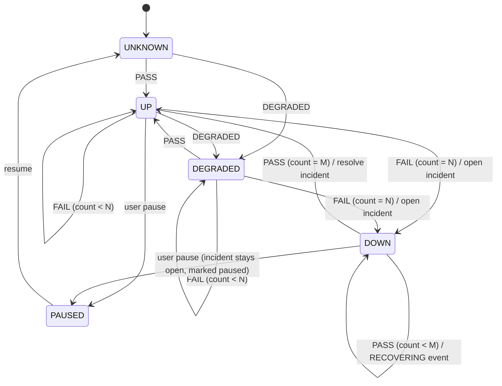

# 08 — Engineering Decisions (ADRs)

Each ADR: **Decision · Alternatives · Trade-offs · What changes at scale · Interview questions.** Status for all: *Proposed* until you approve the plan. New decisions during the build go in `docs/adr/NNN-title.md` using the template.

---

## ADR-001 — Stack: Python 3.12, FastAPI, SQLAlchemy 2.0 async, httpx, Postgres 16
- **Decision:** async end-to-end (FastAPI + `asyncpg` + `httpx.AsyncClient`). One mental model for I/O concurrency in both processes.
- **Alternatives:** (a) sync SQLAlchemy + threads for probes; (b) Go (Gatus is Go — great concurrency, but a new language dilutes the learning focus); (c) Node.js.
- **Trade-offs:** async SQLAlchemy has sharp edges (lazy loading raises, session-per-task rules). Mitigation: `expire_on_commit=False`, explicit `selectinload`, one `AsyncSession` per request/task, never shared across tasks.
- **Interview Qs:** What is the event loop? What happens if you call a blocking function (e.g. `time.sleep`, `socket.getaddrinfo` sync) inside a coroutine? Why is async a good fit for many slow network calls but not CPU work?

## ADR-002 — Postgres is the job queue (lease + `FOR UPDATE SKIP LOCKED`)
- **Decision:** due work = rows in `monitor_state` with `next_run_at <= now()`. Workers claim with `SKIP LOCKED` and set a time-bounded lease. Completion is conditional on still owning the lease and idempotent via `UNIQUE(monitor_id, scheduled_for)`.
- **Alternatives:** APScheduler in-process (state in memory or its own job store; duplicate runs with >1 process); Celery + Redis beat (two more components, beat is a single point of failure); cron + script (no sub-minute intervals, no ownership).
- **Trade-offs:** + one datastore, transactional with run/incident writes, survives restarts. − polling adds up to `poll_interval` (1 s) latency; DB load grows with workers × poll rate (trivial here).
- **At scale:** partition `monitor_state` by hash and give worker groups shards; or move to a real queue when *measured* claim contention appears.
- **Interview Qs:** What exactly does `SKIP LOCKED` do and what anomaly does it accept? Why is a lease needed in addition to the row lock? (Row lock is released at TX1 commit.) What is a fencing token and how does `WHERE lease_owner = :me` approximate one? What if the worker's clock is wrong? (We use DB `now()`.)

## ADR-003 — Modular monolith, two processes (api, worker)
- **Decision:** same codebase/image, different entrypoint. API never schedules.
- **Alternatives:** scheduler inside FastAPI lifespan (simplest, but every API replica becomes a scheduler; probe load competes with request latency); separate microservices (no independent scaling/ownership benefit at this size).
- **Interview Qs:** What are you isolating by splitting processes? How would you deploy 3 API replicas and 2 workers? What's shared and what's the blast radius of a bad deploy?

## ADR-004 — Separate `monitors` (config) from `monitor_state` (runtime)
- **Decision:** user-owned config vs worker-owned state, 1:1.
- **Why:** clear write ownership; smaller hot row for the claim loop; user edits don't conflict with worker updates; easier reasoning about who may change what.
- **Interview Qs:** What is "state ownership"? What race exists if the user edits the interval while a probe is in flight? (Answer: TX2 reads the current interval when computing next_run_at — define that rule explicitly.)

## ADR-005 — Scheduling semantics
- **Decision:** `next = scheduled_for + interval`; if `next < now()`, set `next = now() + small jitter` (skip missed slots, no backfill). New monitors start at `now() + random(0, interval)` to avoid thundering herds. Poll loop: every 1 s, claim `min(free_slots, 50)`.
- **Alternatives:** next = completion + interval (drifts later every run); backfill all missed slots (catch-up storm after downtime).
- **Interview Qs:** Fixed-rate vs fixed-delay scheduling? What is a thundering herd? What happens after a 10-minute outage of all workers?

## ADR-006 — Timeouts and retries
- **Decision:** per-phase httpx timeouts + overall `asyncio.timeout`; one retry only for connection-level transient classes (see `07` §5).
- **Alternatives:** no retry (more false alarms); exponential multi-retry (masks real problems, multiplies load on a failing service — retry storms).
- **Interview Qs:** Connect timeout vs read timeout? Why not retry a read timeout? What's a retry storm and how do backoff + jitter + budgets prevent it? Why do idempotent methods matter for retries?

## ADR-007 — Incident state machine
- **Decision:** pure function `evaluate(state, outcome, thresholds)`. `FAIL` increments `consecutive_failures` and resets successes; `PASS/DEGRADED` increments successes and resets failures; `INCONCLUSIVE` changes **nothing**. Open when failures reach `failure_threshold` (backdate `opened_at` to the first failure of the streak). Resolve when successes reach `recovery_threshold`. Partial unique index guarantees one open incident.
- **Alternatives:** open on first failure (noisy); percentage-of-window (harder to explain, better for very frequent checks).
- **Interview Qs:** Draw the state diagram. What's hysteresis and why use two thresholds? What does the partial unique index protect against if your code already checks?

*(Note: `INCONCLUSIVE` is a self-loop on every state and is omitted for readability. Pausing while `DOWN` keeps the incident open; decide in M5 whether pause should auto-resolve — record as an ADR.)*

## ADR-008 — Opaque server-side sessions; argon2id passwords
- **Decision:** 32-byte random token in httpOnly cookie; store SHA-256 hash; revocable; logout and password change revoke all sessions. Password hashing with `argon2-cffi` (argon2id) — or `bcrypt` if you prefer familiarity; record the choice.
- **Alternatives:** JWT access + refresh (you've done this at GoPerch; stateless but revocation needs a denylist anyway).
- **Why hash the token?** A DB leak shouldn't yield usable sessions (same reason passwords are hashed; a fast hash is fine because tokens are high-entropy).
- **Interview Qs:** JWT vs sessions — when is each better? What does `SameSite=Lax` stop? Why does Uptime Kuma's CVE-2023-49804 matter to your design?

## ADR-009 — `INCONCLUSIVE` outcome
- **Decision:** probe-side problems (our bug, our resolver broken, policy block during schedule, next-iteration canary failure) are recorded but excluded from incidents and uptime.
- **Why:** a monitor that blames the target for its own failures erodes trust. This is the concrete answer to "separate application failures from target failures".
- **Interview Q:** How do you know the failure is yours and not theirs? (Canary, classification of internal exceptions, worker health.)

## ADR-010 — GET/HEAD only; redirects not followed (MVP)
- **Decision:** safe, idempotent methods only. 3xx is recorded with `Location`; counts as allowed by default.
- **Why:** POST probes can create data repeatedly and can't be blindly retried; redirects are a classic SSRF bypass (public URL → 302 → `169.254.169.254`).
- **Next iteration:** optional follow (≤ 3 hops) with every hop re-resolved and re-validated.

## ADR-011 — SSRF guard with resolve-validate-pin
- **Decision:** resolve ourselves, reject if any IP is non-public, connect to the validated IP with Host/SNI set to the hostname. Details in `09_SECURITY.md` §3.
- **Alternatives:** validate hostname string only (bypassed by DNS); validate then let httpx resolve again (TOCTOU / DNS rebinding); egress proxy (e.g. Smokescreen) — strong, but another component.
- **Interview Qs:** What is DNS rebinding? Why is checking the URL string insufficient? Name five forms of "localhost".

## ADR-012 — Deployment
- **Decision (default):** dev = docker compose. Demo deployment = one small VM on a major cloud (your choice of AWS EC2, Azure VM or GCP Compute Engine) running docker compose with Caddy for automatic HTTPS, firewall allowing only 22 (your IP) / 80 / 443. Postgres in a container with a volume + nightly `pg_dump` to object storage. **Verify current free-tier/credit terms yourself before provisioning.**
- **Alternative:** stay on Render (you already know it) — perfectly fine if cloud experience isn't a priority. Managed Postgres (RDS / Cloud SQL / Azure DB) — better ops, more cost.
- **Interview Qs:** What did you expose to the internet and why? Where do secrets live? How do you back up and restore? How would you do zero-downtime deploys?

## ADR-013 — Frontend: React + Vite + TypeScript SPA, TanStack Query, Recharts
- **Why not Next.js:** no SEO/SSR need, auth via same-origin cookie is simpler with the API serving the SPA, and it avoids repeating FindMine's stack. Recharts reused from GoPerch/FlowBench (familiar → focus elsewhere).
- **Interview Q:** How does TanStack Query handle caching, refetch intervals and stale data on the monitor detail page?

## ADR-014 — (Stretch) LLM incident brief
- **Decision if pursued:** input = the incident evidence JSON (no URLs with query strings, no headers, no bodies); output = ≤ 120-word summary that must cite run IDs and must answer "insufficient evidence" when baseline samples < 20; temperature 0; off by default (`LLM_ENABLED=false`); provider key via env; results cached per incident version; evaluated on ≥ 10 labelled fixtures with a scripted check (citations exist, no invented numbers). Deterministic hints remain the primary explanation.
- **Responsible-AI talking points:** grounding, data minimisation, human stays in control, measurable evaluation, graceful degradation when the API is down.
- **Skip it if** it delays MVP; it is not needed to prove SWE fundamentals.

## ADR-015 — Deterministic network testing
- **Decision:** tests run against Faultline in-process (uvicorn on an ephemeral port in a pytest fixture), a raw asyncio TCP server for socket-level faults, an injected fake resolver for DNS, and `trustme` for local TLS certificates. No public internet, no `time.sleep` beyond small real timeouts (≤ 1.5 s, configured short in tests).
- **Interview Q:** How do you test a connect timeout deterministically? (Connect to a non-routable address is flaky across environments; prefer a resolver/transport seam or a listening socket with a full backlog — evaluate in M2 and document what you chose.)

## ADR-016 — Observability libraries
- **Decision:** stdlib `logging` with a small JSON formatter (or `structlog` if you want — justify), `prometheus_client` for `/metrics`. No OpenTelemetry in MVP.
- **Interview Q:** Logs vs metrics vs traces — which answers which question?

## ADR-017 — Phase timings come from httpcore trace hooks
- **Context:** M2 spike. We need DNS / connect / TLS / TTFB per attempt without a custom HTTP client.
- **Decision:** pass `extensions={"trace": callback}` to httpx. With the installed httpcore, an HTTPS request emits (in order) `connection.connect_tcp.started/complete`, `connection.start_tls.started/complete`, `http11.send_request_headers.*`, `http11.send_request_body.*`, `http11.receive_response_headers.started/complete`, `http11.receive_response_body.*`, `http11.response_closed.*`. Derived values: `connect_ms` = connect_tcp span, `tls_ms` = start_tls span, `ttfb_ms` = receive_response_headers span (server think time to first byte of headers). **DNS is not exposed by httpcore**: the engine resolves the hostname itself (injected `Resolver`), times that, then connects to the chosen IP with `Host` and `sni_hostname` set (which is also what M3's IP pinning needs).
- **Consequences:**
  - A custom `transport` (used in tests) bypasses the trace events, so those attempts have no connect/TLS/TTFB numbers.
  - The tracked *phase* (dns/connect/tls/headers/body) is what turns a bare `TimeoutError` from the overall deadline into the specific class: connect -> CONNECT_TIMEOUT, headers -> READ_TIMEOUT, body -> TOTAL_TIMEOUT.
  - Event names are an httpcore implementation detail; pin httpcore via the lockfile and keep the engine integration tests, which fail if names change.
  - On Windows a refused loopback connect takes about 2 s to be reported (SYN retries), so the CONNECTION_REFUSED test uses a 5 s budget.
- **Connect-timeout testing (ADR-015 question):** a transport seam that never returns, not a non-routable address. The classification of a real `httpx.ConnectTimeout` is covered by a unit test.

## ADR-018 — SSRF guard implementation notes (M3)
- **Decision:** `app/probe/ssrf.py` holds an `SsrfPolicy` (ports, dev CIDR override, dev host allow-list) with two operations: `validate_url` (static; `TargetError` for malformed, `BlockedTarget` for denied) and `allows_ip`. The engine resolves, requires `allows_ip` for **every** answer, then connects to one validated IP with `Host` and `sni_hostname` set to the original name. The default policy is strict; localhost-style tests opt in with an explicit `allow_private_cidrs`.
- **IPv6 embedding IPv4:** `::ffff:a.b.c.d`, NAT64 `64:ff9b::/96` and 6to4 `2002::/16` are unwrapped and judged as the embedded IPv4. Teredo, local-use NAT64, `::/96`, discard and ULA ranges are rejected outright.
- **Numeric hosts:** a hostname whose last label is purely numeric or `0x..` is rejected rather than parsed (`2130706433`, `0x7f.1`, `017700000001`, `127.1`); real DNS names never end in a numeric label.
- **Spike result:** TLS verification works against the original hostname while connecting by IP (`sni_hostname` drives both SNI and certificate hostname checks): a cert for the right name passes, a cert for another name gives `TLS_CERT_INVALID`.
- **Residual risk:** a hostname that is on `ALLOWED_HOSTS` or covered by `SSRF_ALLOW_PRIVATE_CIDRS` bypasses the guard by design (dev only; the app logs a warning). The guard does not defend against a public IP that itself proxies to private space.
- **Static HTTP-client rule:** a unit test fails if `httpx` is imported anywhere under `app/` outside `app/probe/`.

## ADR-019 — Worker claim/complete design (M4)
- **Decision:**
  - **Claim (TX1):** one statement, `SELECT ... FOR UPDATE OF s SKIP LOCKED` in a CTE feeding an `UPDATE` that sets `lease_owner` and `lease_expires_at = now() + (2 x timeout + 15 s)`, committed immediately. Eligible rows are unpaused, `next_run_at <= now()`, and either unleased or lease-expired.
  - **Execute:** no transaction open; bounded by `MAX_CONCURRENCY` (claim limit = free slots, plus a semaphore).
  - **Complete (TX2):** `INSERT ... ON CONFLICT (monitor_id, scheduled_for) DO NOTHING`, then `UPDATE monitor_state ... WHERE lease_owner = :me`, one transaction.
- **Why the lease is needed besides the row lock:** the `FOR UPDATE` lock dies at TX1 commit, but the probe takes seconds. The lease is the lock that survives across transactions, with an expiry so a dead worker cannot hold a monitor forever.
- **Fencing:** the `lease_owner = :me` predicate. If our lease expired and B took over, our UPDATE matches 0 rows and we leave state alone (`LEASE_LOST`). We may still have inserted the run; B's later insert conflicts and B still advances the slot (`DUPLICATE`). Without that second rule a lost-race slot would be re-claimed forever (found while designing the test, `test_expired_lease_taken_over_then_original_finishes_late_is_fenced`).
- **Limit:** not a true fencing token. A paused-for-minutes worker that wakes after B finished and released could still overwrite state if it re-acquired the lease name; names are per-process (`host-pid`) so this needs a restart race. A monotonically increasing lease generation column would close it; not worth it at this scale.
- **Time:** all comparisons use the database `now()`. Tests pass an explicit `now` to claim/complete.
- **Interval edits:** TX2 reads the *current* `interval_seconds`, so an edit during a probe applies to the next slot.
- **Shutdown:** stop claiming, wait up to `SHUTDOWN_GRACE_S` for in-flight probes, cancel the rest and `release_leases` so they are claimable immediately; nothing half-written exists because evidence is only written in TX2. Exit code 0.
- **DB outage:** claim loop catches database errors, backs off 1 s -> 30 s (x2, +-25 % jitter), keeps heartbeating attempts, and resumes without a restart.
- **Measured claim plan** (20 000 monitors, ~93 % overdue so almost everything is eligible, local Postgres 16, `LIMIT 20`): sequential scans + sort, **execution time 11.2 ms**. The planner chose seq scans because most rows qualify. Not yet measured: the steady-state shape (few due rows), where the partial `ix_state_due` index should be used; revisit with real numbers in M8/M10 rather than claiming it now.
- **Interview Qs answered by tests:** two workers racing (`test_concurrent_claims_never_return_the_same_monitor`), lease expiry while probing (fenced test), kill -9 (`test_kill9_leaves_lease_and_another_worker_recovers_ac3`), graceful stop (`..._ac12`), no catch-up storm (`..._ac11`).

## ADR-020 — Incident implementation decisions (M5)
- **Pure evaluation, persisted by the service.** `incidents/state_machine.evaluate(state, outcome, ...)` returns `(new_state, transitions)` and does no I/O. `complete_run` loads the state row with `FOR UPDATE` (only if it still owns the lease), calls `evaluate`, then writes run, counters, incident and events in the same TX2. Because it is one transaction, a crash cannot record a run without its incident effect.
- **State lives in `monitor_state`:** counters, `incident_open`, the first run/time of the current failure streak (for backdating `opened_at`) and two class-count maps (current streak; open incident). Counts are state, not recomputed from `check_runs`, so the pure function needs no history.
- **`opened_at` is the first failing run's `started_at`**, not the run that crossed the threshold; `first_failure_run_id` points at it. Events carry the detecting run.
- **INCONCLUSIVE is a no-op on every counter.** It neither extends a failure streak nor counts as recovery nor resets anything (AC9). Consequence: a monitor whose probes are all inconclusive stays in its previous health, which can look stale; M8's System page must show the inconclusive rate so that is visible.
- **DEGRADED counts as success** for recovery. A resolved incident reports health `DEGRADED` if the resolving run was degraded.
- **A failure while recovering** resets the success counter and keeps the same incident (hysteresis); a new incident can only open after the previous one resolved.
- **Dominant class ties** break alphabetically so output is deterministic.
- **Decision (pause):** pausing a monitor does **not** auto-resolve an open incident. Nothing was observed to be healthy, so claiming recovery would be invented evidence. On resume (M6) the incident stays open, health shows `DOWN`, counters reset, and `recovery_threshold` consecutive successes are needed to resolve. Alternative considered: resolve on pause, which hides ongoing outages when someone pauses to silence noise.
- **Unique index** `one_open_incident` is the backstop: even a buggy service cannot create two open incidents for one monitor (tested by inserting one directly).
- **Hints** are pure rules over `IncidentFacts` (`incidents/hints.py`); the baseline is the 7-day median of PASS runs before `opened_at`, and with fewer than 20 samples a timing failure yields `H_NO_BASELINE` rather than a guess. `build_incident_evidence` assembles first/latest failing run, class counts, baseline and hints for the API in M6.
- **Interview Qs:** draw the machine (see ADR-007 diagram); why two thresholds (hysteresis); what the partial unique index protects against; why counts are state; what pausing should mean.

## ADR-021 — API layer decisions (M6)
- **Password hashing:** `argon2-cffi` (argon2id, library defaults), run via `asyncio.to_thread` so ~tens of ms of CPU do not block the event loop. Unknown emails verify against a dummy hash so login cost and the response are the same either way; the error is a generic 401.
- **Sessions:** 32-byte URL-safe token in an `HttpOnly; SameSite=Lax` cookie (`Secure` when `COOKIE_SECURE`), SHA-256 stored in `sessions`, server-side expiry and revocation, `last_seen_at` written at most once a minute.
- **CSRF:** `SameSite=Lax` plus a required `X-Requested-With: signalnest` header on every unsafe method (a cross-site form cannot set it). Applied by a router dependency, including login and register.
- **Rate limits:** in-process fixed windows (login 5 failures / 15 min per email+IP, probe test 6/min per user, check-now 1/10 s per monitor). Limitation recorded in `ratelimit.py`: with N API replicas the effective limit is N times higher and a restart resets it. Fixed windows allow a burst of 2x at a window boundary; acceptable here.
- **Ownership:** every monitor/run/incident lookup filters by `owner_id` (runs and incidents via a join through `monitors`) and returns 404. A route-crawler test walks the OpenAPI document and requires 404 for a second user on every route with an id parameter.
- **SSRF pre-check at create/edit:** static URL rules, literal IP check, and resolution of the hostname; any denied address -> 422 `blocked-target`. A name that does not resolve yet is accepted (the service may not be deployed). Execution still re-checks on every attempt.
- **Pagination:** keyset on `(started_at, id)` for runs and `(is_open, opened_at, id)` for incidents, opaque base64 cursors. A test inserts a run between page fetches and shows the next page does not shift (offset pagination would).
- **Uptime definition:** `(PASS + DEGRADED) / (PASS + DEGRADED + FAIL)` over the window; `INCONCLUSIVE` is excluded. Limits: it counts *checks*, not time, so it is only comparable between monitors with similar intervals; a monitor with few samples is noisy; paused periods contribute no samples. Latency percentiles use healthy runs only so timeouts do not look like latency.
- **Delete:** incidents are removed explicitly before the monitor because `incidents -> check_runs` is `ON DELETE RESTRICT`.
- **Interval floor:** `MIN_INTERVAL_S` (default 30) enforced in the API; the DB check only requires 1-3600 so tests can use short intervals.
- **Docs UI:** `/api/docs` is controlled by `EXPOSE_DOCS`.

