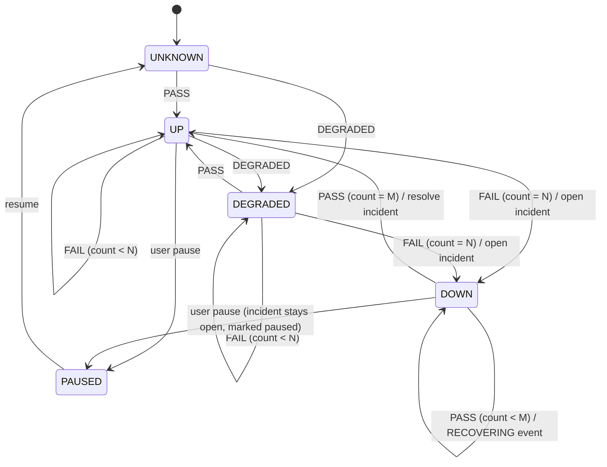

# 08 — Engineering Decisions (ADRs)

Each ADR: **Decision · Alternatives · Trade-offs · What changes at scale · Interview questions.** Status for all: *Proposed* until you approve the plan. New decisions during the build go in `docs/adr/NNN-title.md` using the template.

---

## ADR-001 — Stack: Python 3.12, FastAPI, SQLAlchemy 2.0 async, httpx, Postgres 16
- **Decision:** async end-to-end (FastAPI + `asyncpg` + `httpx.AsyncClient`). One mental model for I/O concurrency in both processes.
- **Alternatives:** (a) sync SQLAlchemy + threads for probes; (b) Go (Gatus is Go — great concurrency, but a new language dilutes the learning focus); (c) Node.js.
- **Trade-offs:** async SQLAlchemy has sharp edges (lazy loading raises, session-per-task rules). Mitigation: `expire_on_commit=False`, explicit `selectinload`, one `AsyncSession` per request/task, never shared across tasks.
- **Interview Qs:** What is the event loop? What happens if you call a blocking function (e.g. `time.sleep`, `socket.getaddrinfo` sync) inside a coroutine? Why is async a good fit for many slow network calls but not CPU work?

## ADR-002 — Postgres is the job queue (lease + `FOR UPDATE SKIP LOCKED`)
- **Decision:** due work = rows in `monitor_state` with `next_run_at <= now()`. Workers claim with `SKIP LOCKED` and set a time-bounded lease. Completion is conditional on still owning the lease and idempotent via `UNIQUE(monitor_id, scheduled_for)`.
- **Alternatives:** APScheduler in-process (state in memory or its own job store; duplicate runs with >1 process); Celery + Redis beat (two more components, beat is a single point of failure); cron + script (no sub-minute intervals, no ownership).
- **Trade-offs:** + one datastore, transactional with run/incident writes, survives restarts. − polling adds up to `poll_interval` (1 s) latency; DB load grows with workers × poll rate (trivial here).
- **At scale:** partition `monitor_state` by hash and give worker groups shards; or move to a real queue when *measured* claim contention appears.
- **Interview Qs:** What exactly does `SKIP LOCKED` do and what anomaly does it accept? Why is a lease needed in addition to the row lock? (Row lock is released at TX1 commit.) What is a fencing token and how does `WHERE lease_owner = :me` approximate one? What if the worker's clock is wrong? (We use DB `now()`.)

## ADR-003 — Modular monolith, two processes (api, worker)
- **Decision:** same codebase/image, different entrypoint. API never schedules.
- **Alternatives:** scheduler inside FastAPI lifespan (simplest, but every API replica becomes a scheduler; probe load competes with request latency); separate microservices (no independent scaling/ownership benefit at this size).
- **Interview Qs:** What are you isolating by splitting processes? How would you deploy 3 API replicas and 2 workers? What's shared and what's the blast radius of a bad deploy?

## ADR-004 — Separate `monitors` (config) from `monitor_state` (runtime)
- **Decision:** user-owned config vs worker-owned state, 1:1.
- **Why:** clear write ownership; smaller hot row for the claim loop; user edits don't conflict with worker updates; easier reasoning about who may change what.
- **Interview Qs:** What is "state ownership"? What race exists if the user edits the interval while a probe is in flight? (Answer: TX2 reads the current interval when computing next_run_at — define that rule explicitly.)

## ADR-005 — Scheduling semantics
- **Decision:** `next = scheduled_for + interval`; if `next < now()`, set `next = now() + small jitter` (skip missed slots, no backfill). New monitors start at `now() + random(0, interval)` to avoid thundering herds. Poll loop: every 1 s, claim `min(free_slots, 50)`.
- **Alternatives:** next = completion + interval (drifts later every run); backfill all missed slots (catch-up storm after downtime).
- **Interview Qs:** Fixed-rate vs fixed-delay scheduling? What is a thundering herd? What happens after a 10-minute outage of all workers?

## ADR-006 — Timeouts and retries
- **Decision:** per-phase httpx timeouts + overall `asyncio.timeout`; one retry only for connection-level transient classes (see `07` §5).
- **Alternatives:** no retry (more false alarms); exponential multi-retry (masks real problems, multiplies load on a failing service — retry storms).
- **Interview Qs:** Connect timeout vs read timeout? Why not retry a read timeout? What's a retry storm and how do backoff + jitter + budgets prevent it? Why do idempotent methods matter for retries?

## ADR-007 — Incident state machine
- **Decision:** pure function `evaluate(state, outcome, thresholds)`. `FAIL` increments `consecutive_failures` and resets successes; `PASS/DEGRADED` increments successes and resets failures; `INCONCLUSIVE` changes **nothing**. Open when failures reach `failure_threshold` (backdate `opened_at` to the first failure of the streak). Resolve when successes reach `recovery_threshold`. Partial unique index guarantees one open incident.
- **Alternatives:** open on first failure (noisy); percentage-of-window (harder to explain, better for very frequent checks).
- **Interview Qs:** Draw the state diagram. What's hysteresis and why use two thresholds? What does the partial unique index protect against if your code already checks?

*(Note: `INCONCLUSIVE` is a self-loop on every state and is omitted for readability. Pausing while `DOWN` keeps the incident open; decide in M5 whether pause should auto-resolve — record as an ADR.)*

## ADR-008 — Opaque server-side sessions; argon2id passwords
- **Decision:** 32-byte random token in httpOnly cookie; store SHA-256 hash; revocable; logout and password change revoke all sessions. Password hashing with `argon2-cffi` (argon2id) — or `bcrypt` if you prefer familiarity; record the choice.
- **Alternatives:** JWT access + refresh (you've done this at GoPerch; stateless but revocation needs a denylist anyway).
- **Why hash the token?** A DB leak shouldn't yield usable sessions (same reason passwords are hashed; a fast hash is fine because tokens are high-entropy).
- **Interview Qs:** JWT vs sessions — when is each better? What does `SameSite=Lax` stop? Why does Uptime Kuma's CVE-2023-49804 matter to your design?

## ADR-009 — `INCONCLUSIVE` outcome
- **Decision:** probe-side problems (our bug, our resolver broken, policy block during schedule, next-iteration canary failure) are recorded but excluded from incidents and uptime.
- **Why:** a monitor that blames the target for its own failures erodes trust. This is the concrete answer to "separate application failures from target failures".
- **Interview Q:** How do you know the failure is yours and not theirs? (Canary, classification of internal exceptions, worker health.)

## ADR-010 — GET/HEAD only; redirects not followed (MVP)
- **Decision:** safe, idempotent methods only. 3xx is recorded with `Location`; counts as allowed by default.
- **Why:** POST probes can create data repeatedly and can't be blindly retried; redirects are a classic SSRF bypass (public URL → 302 → `169.254.169.254`).
- **Next iteration:** optional follow (≤ 3 hops) with every hop re-resolved and re-validated.

## ADR-011 — SSRF guard with resolve-validate-pin
- **Decision:** resolve ourselves, reject if any IP is non-public, connect to the validated IP with Host/SNI set to the hostname. Details in `09_SECURITY.md` §3.
- **Alternatives:** validate hostname string only (bypassed by DNS); validate then let httpx resolve again (TOCTOU / DNS rebinding); egress proxy (e.g. Smokescreen) — strong, but another component.
- **Interview Qs:** What is DNS rebinding? Why is checking the URL string insufficient? Name five forms of "localhost".

## ADR-012 — Deployment
- **Decision (default):** dev = docker compose. Demo deployment = one small VM on a major cloud (your choice of AWS EC2, Azure VM or GCP Compute Engine) running docker compose with Caddy for automatic HTTPS, firewall allowing only 22 (your IP) / 80 / 443. Postgres in a container with a volume + nightly `pg_dump` to object storage. **Verify current free-tier/credit terms yourself before provisioning.**
- **Alternative:** stay on Render (you already know it) — perfectly fine if cloud experience isn't a priority. Managed Postgres (RDS / Cloud SQL / Azure DB) — better ops, more cost.
- **Interview Qs:** What did you expose to the internet and why? Where do secrets live? How do you back up and restore? How would you do zero-downtime deploys?

## ADR-013 — Frontend: React + Vite + TypeScript SPA, TanStack Query, Recharts
- **Why not Next.js:** no SEO/SSR need, auth via same-origin cookie is simpler with the API serving the SPA, and it avoids repeating FindMine's stack. Recharts reused from GoPerch/FlowBench (familiar → focus elsewhere).
- **Interview Q:** How does TanStack Query handle caching, refetch intervals and stale data on the monitor detail page?

## ADR-014 — (Stretch) LLM incident brief
- **Decision if pursued:** input = the incident evidence JSON (no URLs with query strings, no headers, no bodies); output = ≤ 120-word summary that must cite run IDs and must answer "insufficient evidence" when baseline samples < 20; temperature 0; off by default (`LLM_ENABLED=false`); provider key via env; results cached per incident version; evaluated on ≥ 10 labelled fixtures with a scripted check (citations exist, no invented numbers). Deterministic hints remain the primary explanation.
- **Responsible-AI talking points:** grounding, data minimisation, human stays in control, measurable evaluation, graceful degradation when the API is down.
- **Skip it if** it delays MVP; it is not needed to prove SWE fundamentals.

## ADR-015 — Deterministic network testing
- **Decision:** tests run against Faultline in-process (uvicorn on an ephemeral port in a pytest fixture), a raw asyncio TCP server for socket-level faults, an injected fake resolver for DNS, and `trustme` for local TLS certificates. No public internet, no `time.sleep` beyond small real timeouts (≤ 1.5 s, configured short in tests).
- **Interview Q:** How do you test a connect timeout deterministically? (Connect to a non-routable address is flaky across environments; prefer a resolver/transport seam or a listening socket with a full backlog — evaluate in M2 and document what you chose.)

## ADR-016 — Observability libraries
- **Decision:** stdlib `logging` with a small JSON formatter (or `structlog` if you want — justify), `prometheus_client` for `/metrics`. No OpenTelemetry in MVP.
- **Interview Q:** Logs vs metrics vs traces — which answers which question?

## ADR-017 — Phase timings come from httpcore trace hooks
- **Context:** M2 spike. We need DNS / connect / TLS / TTFB per attempt without a custom HTTP client.
- **Decision:** pass `extensions={"trace": callback}` to httpx. With the installed httpcore, an HTTPS request emits (in order) `connection.connect_tcp.started/complete`, `connection.start_tls.started/complete`, `http11.send_request_headers.*`, `http11.send_request_body.*`, `http11.receive_response_headers.started/complete`, `http11.receive_response_body.*`, `http11.response_closed.*`. Derived values: `connect_ms` = connect_tcp span, `tls_ms` = start_tls span, `ttfb_ms` = receive_response_headers span (server think time to first byte of headers). **DNS is not exposed by httpcore**: the engine resolves the hostname itself (injected `Resolver`), times that, then connects to the chosen IP with `Host` and `sni_hostname` set (which is also what M3's IP pinning needs).
- **Consequences:**
  - A custom `transport` (used in tests) bypasses the trace events, so those attempts have no connect/TLS/TTFB numbers.
  - The tracked *phase* (dns/connect/tls/headers/body) is what turns a bare `TimeoutError` from the overall deadline into the specific class: connect -> CONNECT_TIMEOUT, headers -> READ_TIMEOUT, body -> TOTAL_TIMEOUT.
  - Event names are an httpcore implementation detail; pin httpcore via the lockfile and keep the engine integration tests, which fail if names change.
  - On Windows a refused loopback connect takes about 2 s to be reported (SYN retries), so the CONNECTION_REFUSED test uses a 5 s budget.
- **Connect-timeout testing (ADR-015 question):** a transport seam that never returns, not a non-routable address. The classification of a real `httpx.ConnectTimeout` is covered by a unit test.

